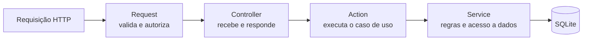

# Sefaz é Massa

Portal de programas fiscais de Alagoas, com cadastro de usuários e área administrativa. Desenvolvido como desafio prático e projeto de estudo — não é um sistema oficial da SEFAZ-AL.

A aplicação é dividida em uma **API REST em Laravel** e uma **SPA em Vue.js**, que se comunicam por tokens de acesso (Laravel Sanctum).


---

## Funcionalidades

- **Cadastro e login** com autenticação por token (Sanctum).
- **Dois perfis de acesso:** usuário comum e administrador.
- **Programas fiscais:** qualquer visitante vê a lista; usuários logados veem os detalhes; somente administradores criam, editam e excluem.
- **Proteção no back-end:** um usuário comum que tentar criar, editar ou excluir pela URL ou direto na API recebe `403`. O papel de admin não pode ser obtido pelo cadastro nem pela edição de perfil.
- **Perfil:** o usuário edita nome e e-mail, troca a senha e pode excluir a própria conta (com confirmação de senha).
- **Mensagens de validação em português.**

## Stack

| Camada | Tecnologias |
| --- | --- |
| Back-end | PHP 8.2, Laravel 12, Laravel Sanctum |
| Front-end | Vue 3, Vue Router, Pinia, Axios, Vite |
| Estilo | Tailwind CSS |
| Banco de dados | SQLite |
| Testes | PHPUnit (testes de feature da API) |
| Ambiente | Docker e Docker Compose |

## Arquitetura do back-end

A API segue uma separação em quatro camadas, cada uma com uma única responsabilidade:



| Camada | Pasta | Responsabilidade |
| --- | --- | --- |
| **Request** | `app/Http/Requests/Api` | Valida os dados de entrada e verifica permissões. Ex.: `StoreProgramaRequest` só deixa passar administradores. |
| **Controller** | `app/Http/Controllers/Api` | Recebe a requisição já validada, chama a Action e devolve a resposta JSON. Não tem regra de negócio. |
| **Action** | `app/Actions` | Um caso de uso por classe: `CreateProgramaAction`, `LoginAction`, `DeleteAccountAction`… |
| **Service** | `app/Services` | Operações reutilizáveis sobre o domínio: `ProgramaService`, `UserService`, `AuthTokenService`. |

Com isso, a regra de negócio fica isolada do HTTP: a mesma Action pode ser reutilizada por um comando Artisan ou por outro controller, e cada camada é testada de forma independente.

## Como rodar

### Com Docker (recomendado)

Pré-requisitos: Docker e Docker Compose.

```bash
git clone https://github.com/ninoozz/desafio-sefaz-e-massa.git
cd desafio-sefaz-e-massa
cp .env.example .env
docker compose up --build
```

Na primeira execução o container instala as dependências, gera a chave da aplicação, cria o banco SQLite e popula os dados de exemplo.

- Front-end: http://localhost:5174
- API: http://localhost:8000/api

Para parar: `docker compose down`

### Sem Docker

Pré-requisitos: PHP 8.2+, Composer e Node.js 20+.

```bash
# Back-end
composer install
cp .env.example .env
php artisan key:generate
touch database/database.sqlite
php artisan migrate --seed
php artisan serve            # http://localhost:8000

# Front-end (em outro terminal)
cd frontend
npm install
npm run dev                  # http://localhost:5174
```

### Usuários de teste

Criados automaticamente pelo seeder (`database/seeders/DatabaseSeeder.php`) para facilitar a avaliação local. **São apenas credenciais de teste.**

| Perfil | E-mail | Senha |
| --- | --- | --- |
| Administrador | admin@sefazemassa.com.br | 12341234 |
| Usuário comum | test@example.com | 12341234 |

## Testes

A API tem testes de feature cobrindo cadastro, login, permissões de administrador, CRUD de programas e perfil:

```bash
php artisan test tests/Feature/Api
```

Alguns exemplos do que é verificado:

- usuário comum recebe `403` ao tentar criar, editar ou excluir um programa;
- não é possível se cadastrar como admin enviando `"role": "admin"`;
- trocar de e-mail remove a verificação, manter o mesmo e-mail não;
- excluir a conta remove também todos os tokens de acesso.

## Endpoints da API

| Método | Rota | Acesso |
| --- | --- | --- |
| `POST` | `/api/register` | Público |
| `POST` | `/api/login` | Público |
| `GET` | `/api/programas` | Público |
| `GET` | `/api/programas/{id}` | Usuário logado |
| `POST` | `/api/programas` | Administrador |
| `PUT` | `/api/programas/{id}` | Administrador |
| `DELETE` | `/api/programas/{id}` | Administrador |
| `GET` | `/api/user` | Usuário logado |
| `POST` | `/api/logout` | Usuário logado |
| `GET` / `PATCH` / `DELETE` | `/api/profile` | Usuário logado |
| `PUT` | `/api/password` | Usuário logado |

Rotas protegidas exigem o cabeçalho `Authorization: Bearer <token>`, retornado no login e no cadastro.

## Estrutura

```
app/
├── Actions/              # casos de uso (Auth, Programa, Profile)
├── Services/             # regras e acesso a dados
├── Http/
│   ├── Controllers/Api/  # controllers da API
│   └── Requests/Api/     # validação e autorização
└── Models/
database/seeders/         # dados de exemplo e usuários de teste
frontend/                 # SPA em Vue 3
tests/Feature/Api/        # testes da API
```

## Próximos passos

- Módulo de **notícias** (CRUD para administradores).
- Tela para um administrador **promover outro usuário** a admin.
- Paginação e busca na lista de programas.
- Testes do front-end.

---

Desenvolvido por [José Ricardo](https://github.com/ninoozz) · [LinkedIn](https://linkedin.com/in/josericardo-dev)
